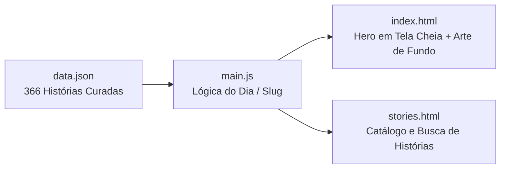
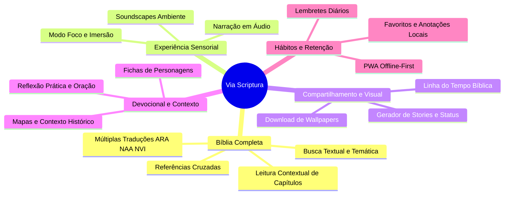
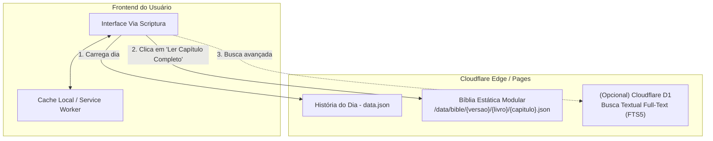

# Via Scriptura — Documento de Evolução & Roadmap Estratégico

> Este documento consolida a visão, propostas de expansão, arquitetura técnica e o planejamento por fases para a evolução do **Via Scriptura**.

---

## 1. Visão Geral e Estado Atual

O **Via Scriptura** é uma plataforma devocional diária que une a leitura bíblica com arte visual imersiva:
- **Base de Conteúdo**: 366 passagens bíblicas curadas cobrindo todo o ano (em versões como ARA e NAA).
- **Interface**: Visual contemplativo em tela cheia com tipografia adaptável, sobreposição sutil e navegação temporal.
- **Stack Tecnológico**: HTML5 semântico, CSS3 moderno, Vanilla JavaScript e hospedagem estática/edge com Cloudflare (`wrangler.jsonc`).

---

## 2. Pilares de Evolução

### Pilar 1: A Bíblia Completa & Contextualização
1. **Leitura Contextual Imediata ("Ler capítulo completo")**:
   - Ao lado da referência da história diária, um botão discreto abre uma gaveta lateral (*drawer*) ou visão expandida contendo o capítulo integral da passagem lida.
   - Mantém o usuário focado na reflexão diária sem que ele precise abrir outro site ou app para checar o contexto.
2. **Comparador e Seletor de Traduções**:
   - Suporte a múltiplas versões bíblicas em português (ARA - Almeida Revista e Atualizada, NAA - Nova Almeida Atualizada, NVI - Nova Versão Internacional, ARC - Almeida Revista e Corrigida).
3. **Navegador Bíblico Completo**:
   - Interface limpa para navegar diretamente por Testamento $\rightarrow$ Livro $\rightarrow$ Capítulo $\rightarrow$ Versículo.
4. **Busca Temática por Sentimento/Momento de Vida**:
   - Índices temáticos para busca além do texto exato: *"Paz em tempos difíceis"*, *"Ansiedade"*, *"Gratidão"*, *"Família"*, *"Perdão"*.

---

### Pilar 2: Experiência Sensorial & Contemplativa
1. **Narração em Áudio (Áudio-Bíblia Integrada)**:
   - Botão flutuante de reprodução para ouvir a história narrada com dicção serena e respeitosa.
   - Possibilidade de uso de gravações existentes sob licença aberta ou geração via IA neural de alta fidelidade (ex: ElevenLabs).
2. **Paisagem Sonora Contemplativa (*Soundscapes*)**:
   - Trilha opcional de fundo ultrabaixa (violoncelo, harpa ambiente, vento suave).
   - Botão liga/desliga com controle de volume independente.
3. **Modo Foco / Zen**:
   - Modo de leitura limpa que esconde cabeçalho, rodapé e controles ao iniciar a rolagem ou via atalho (tecla `F`), destacando unicamente a arte e o texto com contraste dinâmico.

---

### Pilar 3: Engajamento Visual & Compartilhamento Social
1. **Gerador de Cards para Redes Sociais (Stories / Status)**:
   - Um botão *"Compartilhar"* que gera dinamicamente via `HTML Canvas` uma imagem no formato 9:16 (1080x1920) e 1:1 (Instagram Feed/WhatsApp).
   - A imagem contém a arte de fundo atual, o versículo do dia tipografado com elegância e a marca d'água discreta `viascriptura.com`.
2. **Linha do Tempo Bíblica Visual**:
   - Em `stories.html`, permitir alternar a visualização por calendário para uma linha do tempo cronológica dos fatos bíblicos:
     $$\text{Criação} \longrightarrow \text{Patriarcas} \longrightarrow \text{Êxodo} \longrightarrow \text{Reis/Profetas} \longrightarrow \text{Evangelhos} \longrightarrow \text{Igreja Primitiva} \longrightarrow \text{Apocalipse}$$
3. **Download de Wallpaper**:
   - Opção para baixar a imagem em alta resolução com ou sem o versículo, para celular e desktop.

---

### Pilar 4: Conteúdo Devocional & Aprofundamento
1. **Reflexão Prática & Oração Guiada**:
   - Card retrátil com duas perguntas devocionais:
     - *O que o texto revela sobre Deus e Seu plano?*
     - *Como aplicar isso ao meu dia hoje?*
   - Uma oração curta inspirada no texto bíblico do dia.
2. **Contexto Histórico e Geográfico**:
   - Minibox explicativo contextualizando data aproximada, autor, destinatários e mapas dos locais citados (ex: Mar da Galileia, Jerusalém, Éfeso).

---

### Pilar 5: Hábitos, Acessibilidade & Retenção
1. **PWA (Progressive Web App) & Leitura Offline**:
   - Adição de `manifest.json` e Service Worker para permitir a instalação como aplicativo nativo no celular (Android e iOS) e leitura das histórias mesmo sem internet.
2. **Lembrete Diário (Notificações Web)**:
   - Opção para o usuário agendar um horário (ex: 06:30 ou 22:00) para receber uma notificação sutil convidando à reflexão do dia.
3. **Privacidade e Recursos Locais (Zero Friction / Sem Login Obrigatório)**:
   - Favoritar passagens preferidas (salvas em `localStorage`).
   - Marca-texto de versículos com destaques em cores suaves.
   - Histórico e contador de dias consecutivos de leitura (*leitura diária contínua*).

---

## 3. Arquitetura Técnica Recomendada

### Para a Bíblia Completa

Para manter o projeto leve, rápido e de custo zero/baixo no Cloudflare, a arquitetura ideal consiste em:

> **Por que dados bíblicos fragmentados por capítulo?**
> A Bíblia inteira em um único JSON pesa entre 4.5 MB e 6.5 MB. Dividir em arquivos estáticos por capítulo (ex: `/data/bible/ara/joao/1.json`) faz com que cada requisição consuma apenas **~2 KB a 5 KB**, mantendo o carregamento instantâneo em qualquer rede móvel.

---

## 4. Cronograma Sugerido de Implementação

| Fase | Escopo Principal | Esforço | Impacto |
| :--- | :--- | :--- | :--- |
| **Fase 1: Quick Wins** | • Gerador de imagem para Stories/Status (Canvas) • Modo Foco em tela cheia • Sistema de favoritos via `localStorage` | 1 a 2 semanas | Alto impacto em compartilhamento orgânico e usabilidade imediata. |
| **Fase 2: Bíblia Completa** | • Estrutura de dados da Bíblia estática modular • Drawer/Modal "Ler Capítulo Completo" • Navegador por Livro/Capítulo/Versículo | 2 a 3 semanas | Dá profundidade espiritual e transforma o app em fonte primária de consulta. |
| **Fase 3: PWA & Hábitos** | • PWA com suporte Offline-first • Notificações diárias configuráveis • Linha do Tempo Cronológica em `stories.html` | 2 semanas | Retenção contínua de usuários e hábito diário. |
| **Fase 4: Multimídia & Devocional** | • Player de áudio com narração • Trilha sonora opcional (*ambient soundscape*) • Reflexão prática e oração diária | 3 semanas | Experiência imersiva de alto valor devocional. |

---

## 5. Próximos Passos & Decisões Recomendadas

1. **Escolha da Tradução Base da Bíblia Completa**:
   - Decidir se o texto base da Bíblia completa será **ARA**, **NAA**, ou se já começamos com um seletor de versões.
2. **Priorização da Primeira Fase**:
   - Iniciar pelos *Quick Wins* visuais (compartilhamento em Stories e favoritos) ou partir direto para a modelagem da *Bíblia Completa*?
